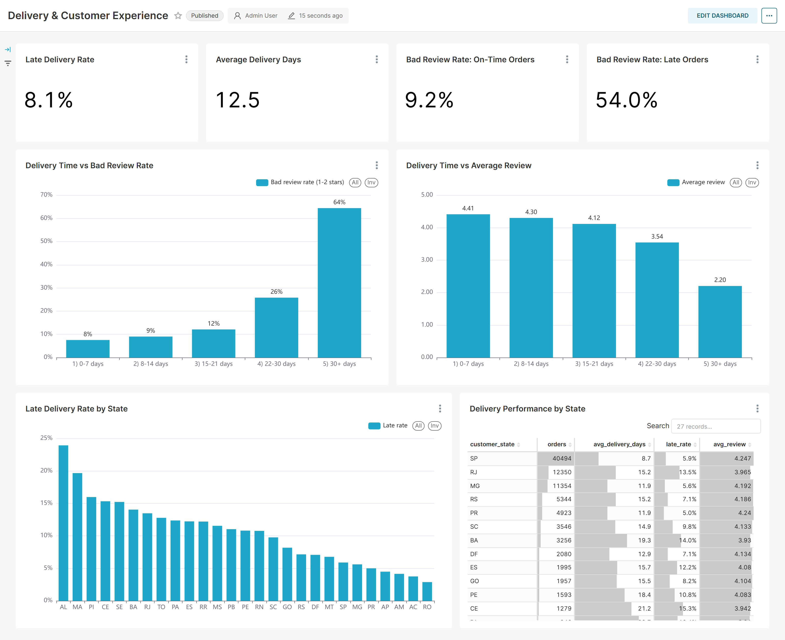

# Olist Brazilian E-Commerce: Customer Behavior Analysis

> An end-to-end analysis of ~100K real orders from a Brazilian marketplace: sales growth, fulfillment, retention and customer value, with a deep dive into **how delivery performance drives review scores**, ending in actionable business recommendations.



<p align="center"><i>Superset dashboard "Delivery &amp; Customer Experience". Other dashboards: <a href="reports/figures/dashboard_overview.png">Business Overview</a> · <a href="reports/figures/dashboard_customers.png">Customer Analytics</a></i></p>

## Key findings

1. **Growth is acquisition-driven; repeat purchases are almost zero.** Monthly orders grew from ~1,700 in 2017 Q1 to ~6,800 in 2018 H1 (about 4x) while average order value stayed between 125 and 153 BRL, so growth came from more customers. Yet **97.0% of customers ordered only once**, month-1 retention is ~0.5%, and GMV plateaued in 2018.
   → The next stage of growth has to come from retention: second-order vouchers 7-30 days after first delivery and replenishment reminders for high-frequency categories.

2. **Delivery is the key driver of customer satisfaction.** About 8% of orders arrive after the promised date. Late orders average **2.57** stars vs **4.29** for on-time orders, and their bad review rate is **54%**, **5.9x** the on-time rate (Mann-Whitney U test p < 0.001, effect size r = 0.55). Alagoas in the northeast has a 23.9% late rate vs 5.9% in Sao Paulo.
   → Give more conservative delivery estimates for remote states, proactively notify and compensate customers when an order will be late, and improve carrier partnerships in the northeast.

3. **Revenue is concentrated and high-value customers are churning.** 30% of customers generate **58% of revenue**. The "At Risk" segment alone (14,058 customers) accounts for 28.9% of revenue but last purchased 446 days ago on average.
   → Spend the win-back budget on this segment first; it has the highest expected return.

4. **Bulky categories underperform.** Among categories with 500+ orders, office furniture has the lowest review score (3.49). Freight is ~35% of item price for furniture, so shipping bulky items is likely dragging scores down.
   → Use specialist large-item carriers and show more accurate delivery estimates on these product pages.

## Business questions

| # | Question | Method | SQL |
|---|---|---|---|
| 1 | How is the platform growing? Customers or basket size? | Monthly GMV, orders and AOV trends; weekday x hour heatmap | [02](sql/02_sales_trend.sql) |
| 2 | Where do orders drop off? | Fulfillment funnel (placed → approved → shipped → delivered) | [03](sql/03_order_funnel.sql) |
| 3 | Do customers come back? | Cohort retention, repeat purchase distribution | [04](sql/04_cohort_retention.sql) |
| 4 | Who are the most valuable customers, and who needs winning back? | RFM segmentation | [05](sql/05_rfm.sql) |
| 5 | **Does delivery affect review scores, and how much?** | Group comparison + Mann-Whitney U test + effect size | [06](sql/06_delivery_vs_review.sql) |
| 6 | Which categories sell well but review poorly? | Category GMV vs average review | [07](sql/07_category_performance.sql) |

The full analysis (charts, statistical test, findings) is in [notebooks/analysis.ipynb](notebooks/analysis.ipynb).

## Tech stack

- **SQL / DuckDB**: data cleaning, modeling and all core metrics
- **Python**: pandas, matplotlib / seaborn, scipy (statistical testing)
- **Apache Superset** (Docker): interactive dashboards, built as code through the Superset REST API

## Data

[Brazilian E-Commerce Public Dataset by Olist](https://www.kaggle.com/datasets/olistbr/brazilian-ecommerce) (Kaggle, CC BY-NC-SA 4.0):
~100K orders from 2016-2018 across 8 related tables (orders, items, payments, reviews, customers, sellers, products, category translation).

Data model (`sql/01_staging.sql`):
- `fct_orders`: one row per order, with order value, payment, review score, delivery days and a late flag
- `fct_order_items`: one row per order item, with English category name and seller details
- `ana_*`: result tables for each business question, used by the notebook and Superset

## Project structure

```
ecommerce-analysis/
├── data/
│   ├── raw/            # original Kaggle CSV files (not committed)
│   ├── sample/         # synthetic sample data, for testing the pipeline only
│   └── processed/      # ecommerce.duckdb and exported CSV files
├── sql/                # 01 cleaning; 02-07 one file per business question
├── scripts/
│   ├── load_data.py                  # CSV → DuckDB, builds the fact tables
│   ├── run_analysis.py               # runs the analysis SQL and exports results
│   ├── build_superset_dashboards.py  # creates the Superset dashboards through the API
│   ├── screenshot_dashboards.py      # takes dashboard screenshots
│   └── make_sample_data.py           # generates synthetic sample data
├── notebooks/analysis.ipynb
├── superset/           # Dockerfile, docker-compose config and exported dashboards (dashboards/)
└── reports/figures/    # notebook charts and dashboard screenshots
```

## How to run

```bash
# 1. Create a virtual environment and install dependencies
python -m venv .venv
.venv\Scripts\activate          # macOS/Linux: source .venv/bin/activate
pip install -r requirements.txt

# 2. Download the Olist dataset from Kaggle and unzip the CSV files into data/raw/
#    (to test the pipeline without it: python scripts/make_sample_data.py,
#     then add --source data/sample to the next step)

# 3. Load the data and build the fact tables
python scripts/load_data.py

# 4. Run the analysis SQL
python scripts/run_analysis.py

# 5. Open the notebook
jupyter lab notebooks/analysis.ipynb
```

## Superset dashboards

Three dashboards with 22 charts in total:

| Dashboard | Contents |
|---|---|
| **Business Overview** | Orders / customers / GMV / review KPIs, monthly GMV and orders, AOV trend, top categories, weekday x hour heatmap |
| **Customer Analytics** | Repeat purchase rate, month-1 retention, high-value revenue share, RFM segments, orders per customer, cohort retention heatmap |
| **Delivery & Customer Experience** | Late rate, delivery days, on-time vs late bad review rates, delivery time vs reviews, late rate and delivery details by state |

Requires [Docker Desktop](https://www.docker.com/products/docker-desktop/) and steps 3-4 above.

```bash
cd superset
copy .env.example .env           # edit .env: set a random SECRET_KEY and the admin password
docker compose up -d --build
docker compose exec superset superset db upgrade
docker compose exec superset superset fab create-admin --username admin --firstname Admin --lastname User --email admin@localhost --password <same password as in .env>
docker compose exec superset superset init
cd ..

# Create the database connection, datasets, charts and dashboards (also re-exports superset/dashboards/)
python scripts/build_superset_dashboards.py
```

Open http://localhost:8088 and log in to see the dashboards. Alternatively, import `superset/dashboards/dashboards_export.zip` from **Dashboards → Import** in the Superset UI.

> Note: run `docker compose stop` before re-running `load_data.py` / `run_analysis.py`, because only one process can write to the DuckDB file at a time.
